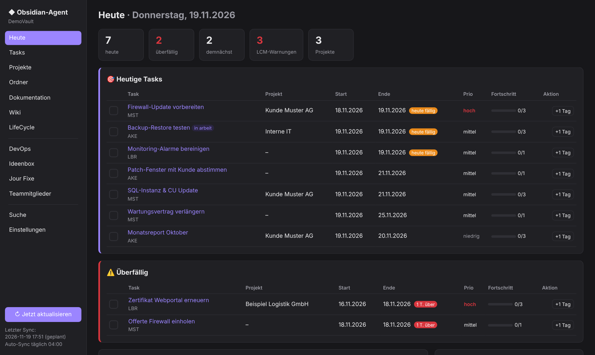
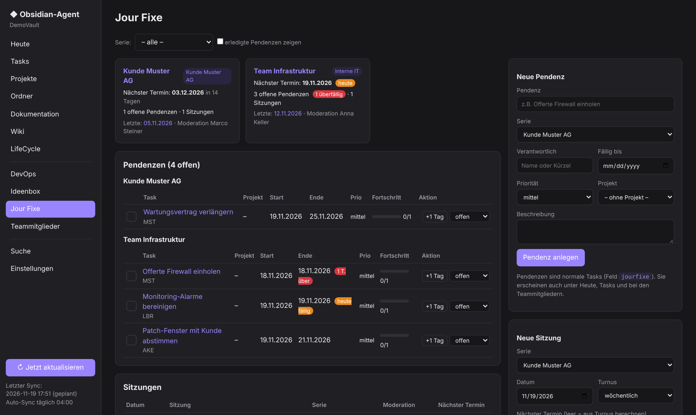
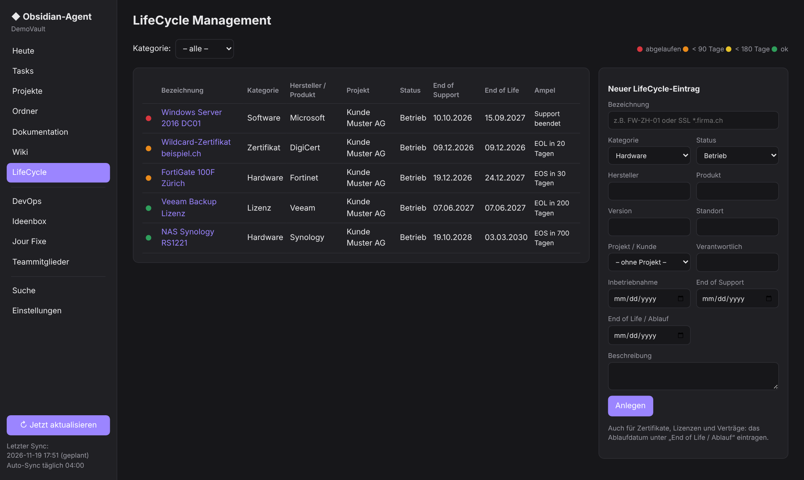
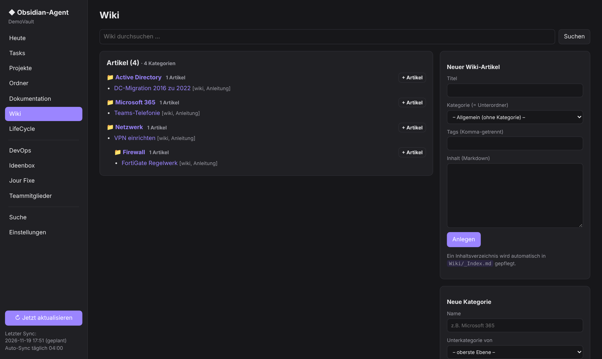
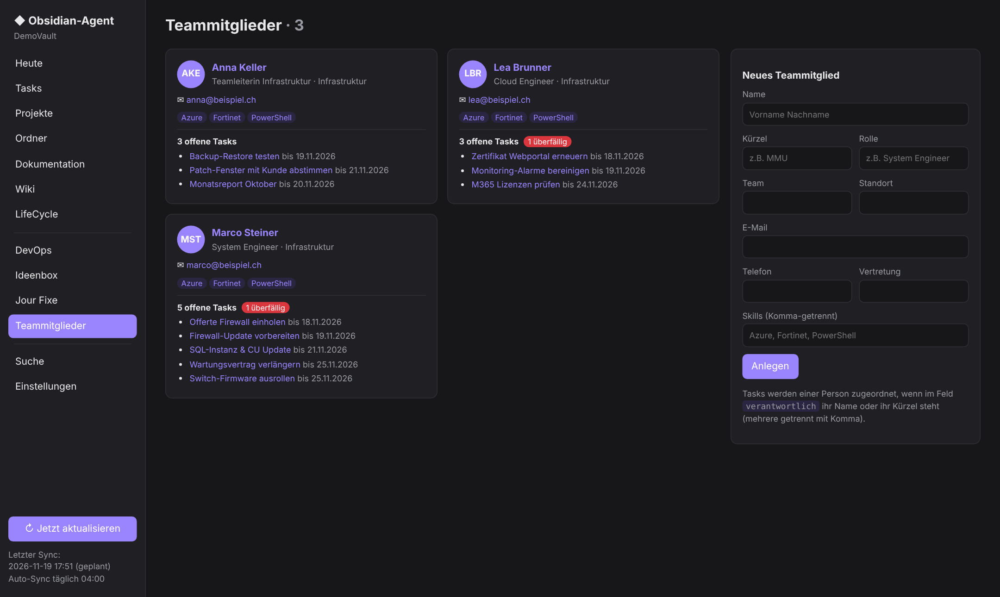
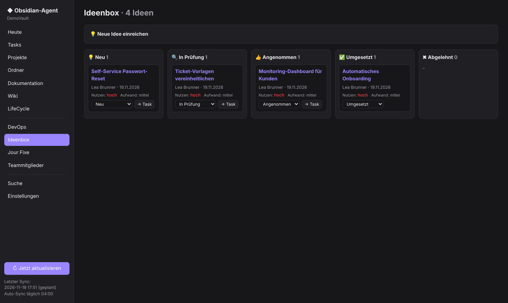

# ◆ Obsidian-Agent

### Dein Obsidian-Vault wird zum Cockpit für Tasks, Projekte, Jour Fixes und LifeCycle.

**Lokal. Ohne Cloud. Ohne Lock-in. Deine Notizen bleiben Markdown.**

`Windows` · `macOS` · `Linux` · `Python 3.10+` · `Läuft unter 127.0.0.1`

---

## Das Problem

Obsidian ist grossartig zum Schreiben und Verknüpfen. Doch sobald darin Projekte, Kunden, Tasks und Verträge laufen, kommt der Moment um acht Uhr morgens:

> *„Was steht heute an? Was ist überfällig? Welches Zertifikat läuft nächsten Monat ab? Was haben wir im letzten Jour Fixe abgemacht?“*

Die Antworten stehen alle irgendwo im Vault, verteilt auf Dutzende Ordner. Plugins helfen beim Anzeigen, brauchen aber ein offenes Obsidian und kennen keine Historie.

## Die Lösung

Der **Obsidian-Agent** ist eine schlanke Weboberfläche, die neben Obsidian läuft. Er liest deinen Vault, ordnet alles und schreibt dir **jeden Morgen um 04:00 eine frische Tagesübersicht**, auch wenn Obsidian geschlossen ist.

| | |
|---|---|
| 🎯 **Ein Blick genügt** | Heute, Überfällig, Demnächst und LifeCycle-Warnungen auf einer Seite |
| 📝 **Markdown bleibt die Wahrheit** | Jeder Task, jedes Protokoll und jeder Eintrag ist eine normale `.md`-Datei. Bearbeite sie in Obsidian, der Agent liest sie wieder ein. |
| 🔗 **Ein Klick, und du bist in Obsidian** | Jeder Titel öffnet die Notiz direkt in Obsidian |
| 🔒 **Bleibt auf deinem Rechner** | Kein Konto, keine Cloud, kein Tracking. Die Oberfläche ist nur unter `127.0.0.1` erreichbar. |
| ⚙️ **Läuft einfach** | Startet bei der Anmeldung im Hintergrund, synchronisiert nachts und holt verpasste Läufe nach |

---

## Funktionen

### 🎯 Heute: der Morgen beginnt mit Klarheit
Die heutigen Tasks stehen oben, darunter das Überfällige, das Demnächst und die LifeCycle-Warnungen. Erledigen mit einem Klick, verschieben mit **„+1 Tag“**. Der Fortschritt wird aus den Checkboxen in der Notiz berechnet.

### ✅ Tasks & Projekte: Ordnung ab dem ersten Klick
- Neue Projekte erhalten automatisch eine **feste Ordnerstruktur**: Verträge & SLA, Kontakte & Eskalation, Technische Doku, Betrieb & Wartung, Reporting, Teilprojekte, Korrespondenz.
- Beim Anlegen eines Tasks wählst du den **Ordner im Projekt**. Auch Ordner, die du von Hand in Obsidian angelegt hast, stehen sofort zur Auswahl.
- Tasks, die du direkt in Obsidian anlegst, auch unterwegs auf dem Handy, sind beim nächsten Sync dabei.

### 🤝 Jour Fixe: keine Pendenz geht mehr verloren

- **Serien** wie „Team Infrastruktur“ oder „Kunde Muster AG“ mit Turnus und nächstem Termin.
- **Jede neue Sitzungsnotiz enthält automatisch die offenen Pendenzen** der Serie. Die Vorbereitung ist erledigt, bevor das Meeting beginnt.
- Pendenzen sind echte Tasks. Sie erscheinen unter *Heute*, bei den *Tasks* und auf der Karte der verantwortlichen Person.

### 🚦 LifeCycle: Abläufe sehen, bevor sie wehtun

Hardware, Software, Lizenzen, Zertifikate und Verträge mit **End of Support** und **End of Life**. Eine Ampel (rot / orange / gelb / grün) zeigt auf einen Blick, wo Handlungsbedarf besteht. Kritische Einträge erscheinen zusätzlich auf der Startseite.

### 📚 Wiki: Wissen, das man wiederfindet

Die Kategorien sind die Ordner im Vault, inklusive Unterkategorien. Du kannst neue Kategorien anlegen, Artikel direkt in eine Kategorie schreiben und im Wiki suchen. Ein Inhaltsverzeichnis `_Index.md` pflegt der Agent automatisch.

### 👥 Teammitglieder: wer macht was?

Personenkarten mit Rolle, Kontakt, Skills und Vertretung. Dazu die offenen und überfälligen Tasks jeder Person, zugeordnet über Name oder Kürzel.

### 💡 Ideenbox: vom Einfall zum Task

Ideen mit Nutzen und Aufwand erfassen und auf dem Board durch die Stationen *Neu → In Prüfung → Angenommen → Umgesetzt* führen. **„→ Task“** macht aus einer Idee einen verlinkten Task.

### Und ausserdem
- **📄 Dokumentation aus Vorlagen:** Meeting, Entscheidung (ADR), Runbook, Change, Störung, Kontakt und Report landen automatisch im passenden Projektordner.
- **🛠️ DevOps:** Pipelines, Deployments, Umgebungen und Repositories mit Status pro Umgebung (Dev / Test / Staging / Prod).
- **🔍 Volltextsuche** über den ganzen Vault.
- **🗂️ Eigene Ordner und Vorlagen:** Die Projektstruktur ist erweiterbar, und alle Vorlagen kannst du in Obsidian anpassen.

---

## Warum nicht einfach ein Plugin?

| | Obsidian-Plugins (z. B. Dataview) | **Obsidian-Agent** |
|---|:---:|:---:|
| Übersicht, auch wenn Obsidian geschlossen ist | – | ✅ |
| Tägliche Historie: wer hat wann was erledigt | – | ✅ |
| Automatische Tagesübersicht um 04:00 (auch auf dem Handy als `Planer/Heute.md`) | – | ✅ |
| Formulare für Tasks, Projekte, Jour Fixe, LifeCycle | – | ✅ |
| Daten bleiben reines Markdown | ✅ | ✅ |

Der Agent ergänzt Obsidian, statt es zu ersetzen. Er läuft unabhängig von Plugins. Deine Kalender-Plugins wie **Timeline Calendar** und **Tasks Timeline** nutzt du weiter wie gewohnt.

---

## In 5 Minuten startklar

**Windows**
1. Python 3.10+ installieren (Häkchen „Add python.exe to PATH“).
2. ZIP entpacken, zum Beispiel nach `C:\Group\obsidian-agent`.
3. **`installieren.bat`** doppelklicken und den Vault wählen. Fertig.

**macOS**
1. ZIP entpacken.
2. **`mac/installieren_mac.command`** doppelklicken. Der Installer führt dich durch alles.

Danach ist die Oberfläche unter **http://127.0.0.1:5055** erreichbar, nach jedem Neustart wieder.
Die ausführliche Anleitung steht in [`Installationsanleitung_Obsidian-Agent.md`](Installationsanleitung_Obsidian-Agent.md).

---

## Sicher und ohne Risiko

- **Dein Vault gehört dir.** Die Datenbank `planer.db` ist nur ein Index und wird bei jedem Sync aus dem Vault neu aufgebaut.
- **Sauber deinstallierbar.** Das Deinstallations-Skript sichert Einstellungen und Datenbank auf den Desktop und entfernt alles andere. **Der Vault wird nie verändert oder gelöscht.**
- **Umzug in Minuten**, auch von Windows auf den Mac.
- **Keine Administratorrechte nötig.**

---

**Weniger suchen. Mehr erledigen.**

*Obsidian-Agent: Das Cockpit für deinen Vault.*

Screenshots zeigen fiktive Beispieldaten.

